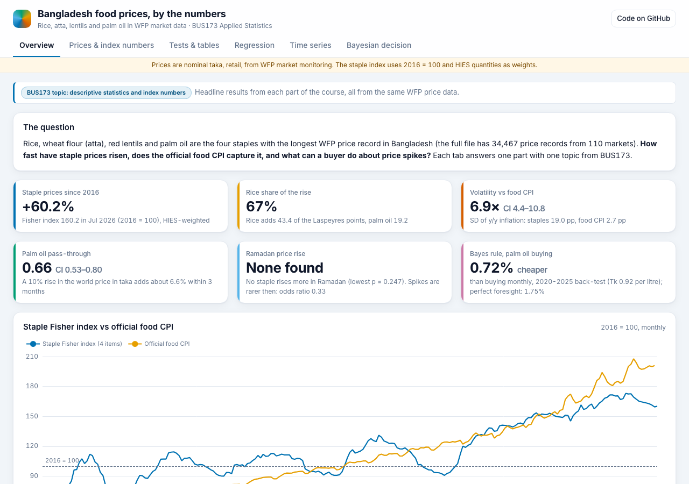
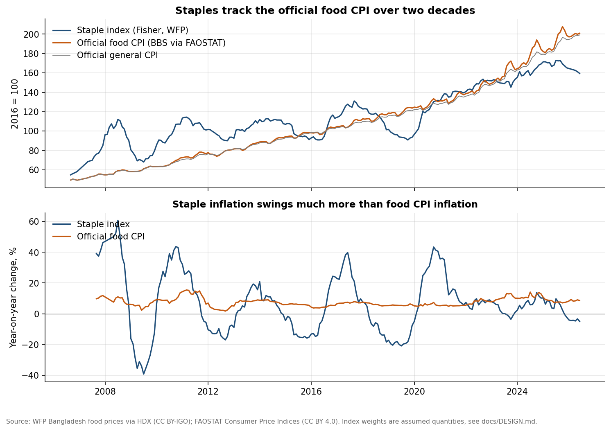
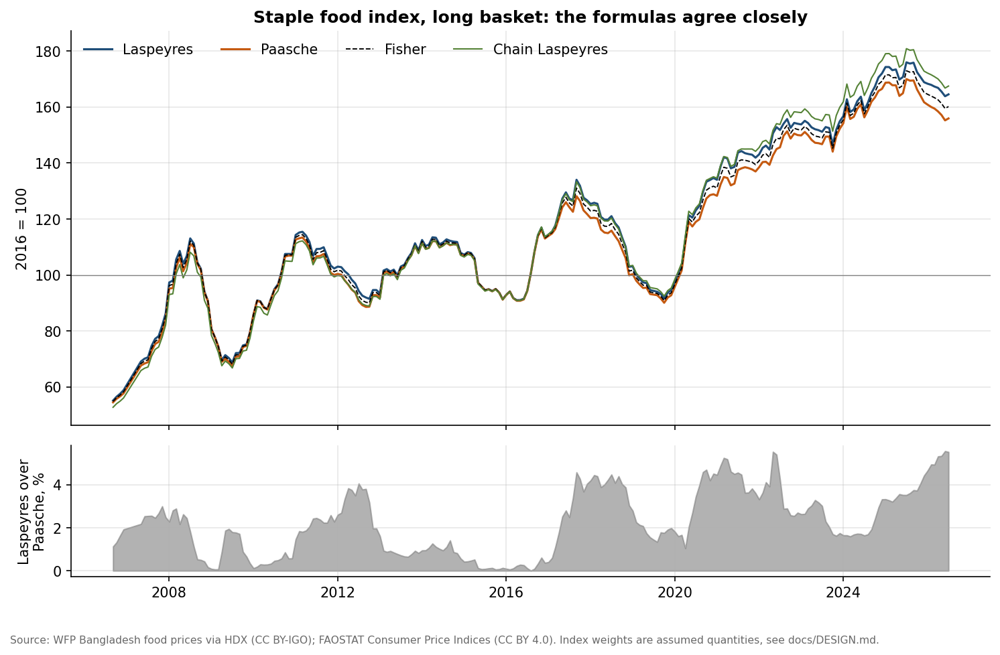
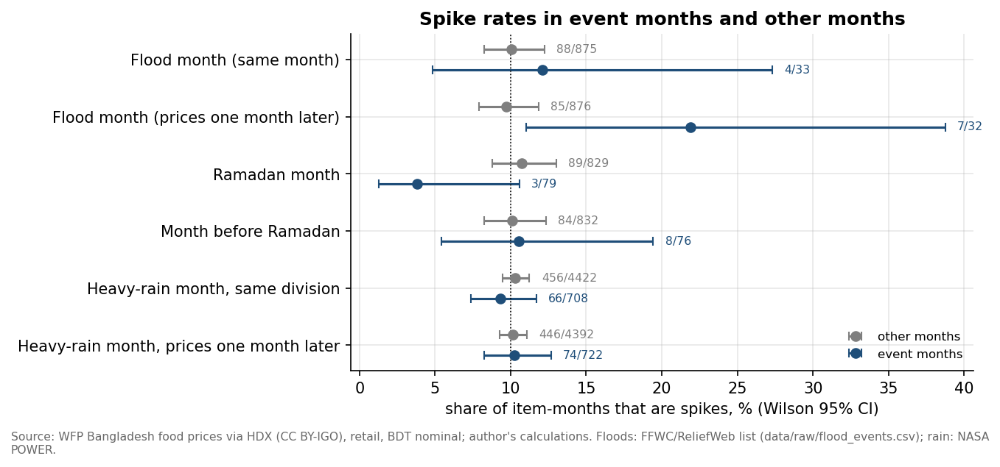
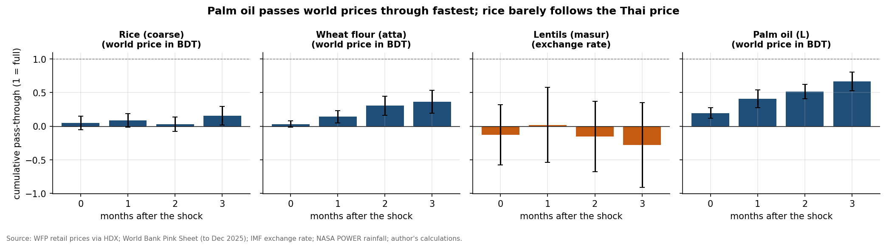
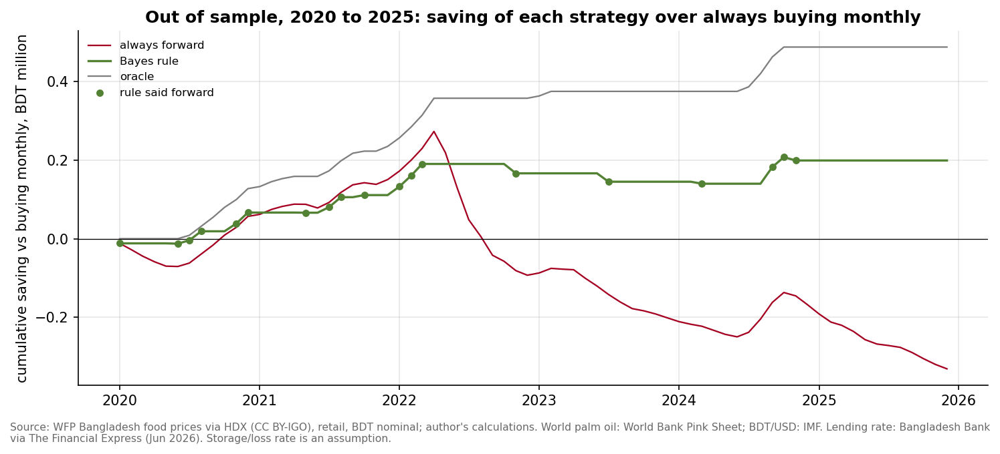

# Bangladesh Food Prices: Applied Statistics with WFP Market Data

<p align="center"><a href="https://takyurp09.github.io/bd-food-price-statistics/"><strong>▶ Open the interactive dashboard</strong></a></p>

[](https://takyurp09.github.io/bd-food-price-statistics/)

Coarse rice, wheat flour (atta), red lentils (masur) and palm oil take a large share of a Bangladeshi household's food budget. This repo asks what drives their prices and how a buyer should act on that. It uses 34,467 monthly price records from the World Food Programme (110 markets, Jul 1998 to Aug 2026). It builds staple price indices and compares them with the official food CPI. It tests common beliefs about Ramadan, floods and regional prices, and measures how much of a world price change reaches local shelves. It also forecasts the next six months and turns the results into a buying rule for palm oil. Each notebook covers one topic from BUS173 Applied Statistics. Prices are nominal taka.

## Key findings

- **Staple prices are up 60% since 2016, and rice drove most of it.** The four-staple Fisher index (2016 = 100, HIES weights) reached 160.2 in Jul 2026. Rice added 43.4 of the Laspeyres index points, 67% of the rise; palm oil added 19.2.
- **The base-year basket overstates the rise.** In Jul 2026 Laspeyres reads 164.5 and Paasche 155.9. The gap peaked at 5.56% in Jun 2026, because households shift toward items that got relatively cheaper. On the 11-item basket with a 2025 base the gap averages 1.38%, against 3.6% for the 2016 basket over the same months.
- **The official food CPI is far smoother than staple prices.** Year-on-year staple inflation has an SD of 19.0 points against 2.7 for the food CPI, a ratio of 6.9 (block bootstrap 95% CI 4.4 to 10.8). Their y/y changes correlate at only r = 0.43, and staples lead the CPI by about one month (r = 0.44). In Jun 2026 the staple index sat 20.6% below the food CPI.
- **There is no Ramadan price surge in the national data.** None of the four staples rises more in Ramadan than in the two months before, net of drift (lowest one-sided p = 0.247). Spikes are rarer in Ramadan months (odds ratio 0.33, Fisher p = 0.051).
- **Divisions differ in price level, not in inflation.** Division explains 30% to 68% of the variance in yearly relative prices (eta squared), but 0 of 4 staples shows a division difference in annual inflation. In 2025 Barishal had the highest division index and Rajshahi the lowest, 7.8% apart.
- **Floods barely move spikes.** A flood month has about the same spike rate as other months (12.1% vs 10.1%, Fisher p = 0.766). The month after a flood looks worse (odds ratio 2.61, Fisher p = 0.035), but a circular-shift permutation test puts p at 0.051, and heavy rain by division shows nothing (odds ratio 1.01).
- **Palm oil follows world prices, rice does not.** A 10% rise in the world palm oil price in taka raises the local price by about 6.6% within three months (pass-through 0.66, 95% CI 0.53 to 0.80). Rice passes through only 0.16 (CI 0.02 to 0.30). Only the palm oil model beats a mean forecast on 2020-2025 data (RMSE ratio 0.69).
- **Seasonality is weak, so forecast bands are wide.** STL puts rice's seasonal strength at 0 on a 0 to 1 scale; its ratio-to-moving-average index runs from 98.2 in June to 101.4 in February. The staple index forecast for Jan 2027 is 160.9, with a 95% interval of 132.8 to 199.6 (ETS, chosen by a 13-origin rolling back-test).
- **A Bayes buying rule saves a little, and the signal is worth little.** A world price signal raises the chance of a palm oil spike next month from 0.099 to 0.345, just above the breakeven of 0.329 for buying three months ahead. On 2020-2025 the rule was 0.72% cheaper than buying monthly, against 1.75% for perfect foresight. The signal is worth Tk 170 per 3,000 L decision (EVSI), 4.6% of the Tk 3,705 that perfect information would be worth (EVPI).



| | |
|---|---|
|  |  |
|  |  |

## BUS173 topic map

| Course topic | Notebook | Main method |
|---|---|---|
| Index numbers | `01_data_and_indices.ipynb` | Laspeyres, Paasche, Fisher and chain indices with HIES weights; contribution analysis; random-weight sensitivity |
| Estimation and hypothesis testing | `02_hypothesis_tests.ipynb` | t and bootstrap confidence intervals, Newey-West intervals, paired tests (Dhaka gaps, Ramadan), one-way ANOVA with Tukey HSD, Holm correction |
| Contingency tables and goodness of fit | `03_contingency_tables.ipynb` | 2 x 2 tables with odds ratios, Fisher exact and permutation tests, chi-square goodness of fit by calendar month, normal vs t fit |
| Correlation, simple and multiple regression | `04_regression_correlation.ipynb` | Pearson and Spearman with Fisher-z CIs, spurious regression demo, distributed-lag pass-through with HAC errors, F and Chow tests, VIF, out-of-sample check |
| Time series | `05_time_series.ipynb` | Ratio-to-moving-average seasonal indices, STL, trend fits, ADF and KPSS, exponential smoothing, SARIMA, rolling back-test |
| Bayesian decision theory | `06_bayesian_decision.ipynb` | Prior and posterior by Bayes' rule, payoff table and EMV, EVPI and EVSI, out-of-sample back-test, beta-binomial update |

## Data and sources

All files were downloaded by `src/download.py` on 24 Oct 2026. URLs and file notes are in [data/raw/SOURCES.md](data/raw/SOURCES.md).

| Data | Source | Licence |
|---|---|---|
| Retail and wholesale food prices by market | World Food Programme, via the Humanitarian Data Exchange | CC BY-IGO |
| Food and general CPI (the BBS index) | FAOSTAT Consumer Price Indices | CC BY 4.0 |
| BDT per USD, monthly | IMF Exchange Rates dataset | IMF copyright and usage terms |
| World prices of rice, wheat and palm oil | World Bank Commodity Price Data (Pink Sheet) | CC BY 4.0 |
| Monthly rainfall at division headquarters | NASA POWER | NASA open data |
| Index weights | BBS, HIES 2022 Final Report, Table 5.2 | Quoted figures, cited |
| Ramadan dates | Computed with `hijridate` (Umm al-Qura) | MIT (package) |
| Flood months | Built here from ReliefWeb, IFRC, OCHA and other reports, each linked | Reports stay under their publishers' terms |
| Lending rate and the 2020-2023 rate cap | Bangladesh Bank, as reported by The Financial Express, The Business Standard and Prothom Alo | Single quoted figures |

## Methods

- **Cleaning** (`src/clean.py`). Within each commodity and market, prices with a robust z above 5 are flagged (342 rows). A second rule drops a division-month whose log price is more than 0.4 from the cross-division median (29 division-months). The national price is a matched-sample chain of division medians, so a division joining or leaving does not move it.
- **Indices** (`src/indices.py`). The long basket (four staples, base 2016) uses HIES 2016 quantities. The short basket (11 items, base 2025) uses HIES 2022. The official CPI is rebased to 2016 for comparison.
- **Tests** (`src/tests_stats.py`). Monthly prices are autocorrelated, so intervals and tests use Newey-West errors, block bootstrap or circular-shift permutations where possible. Holm correction runs within each section: 66 of 152 tests in notebook 02 and 12 of 38 in notebook 03 stay significant.
- **Regression** (`src/regression.py`). Monthly log changes of the local price on lags 0 to 3 of the world price in taka, plus rain anomaly, flood, Ramadan and WFP design-break dummies, with Newey-West errors. Long-run pass-through is the sum of the lag coefficients, with a Wald test.
- **Time series** (`src/timeseries.py`). Seasonal naive, damped-trend ETS and SARIMA on log prices, compared by MASE at horizons 1 to 6 over 13 rolling origins (Jul 2022 to Jul 2025).
- **Decision** (`src/bayes_decision.py`). Buy 3,000 L of palm oil now or 1,000 L a month. Likelihoods, spike threshold and price paths come from 2007-2019 only; 2020-2025 is the test period. Carry cost is the 11.86% lending rate plus 0.5% a month storage and loss (an assumption).

## Validation and limits

- **WFP coverage changes.** Before 2020 the long-basket prices come from 7 division-level markets; in 2025, 66 markets report core items. The 11-item basket only has all items from Sep 2024 (19 months), so most results use the four staples. WFP changed its survey design in July 2020. The national log changes show no jump there, and the regressions carry a dummy for it.
- **Chain method.** The plain mean of division medians jumps when divisions enter or leave (rice has 67 months with fewer than six divisions). The chained national price differs from the plain mean by at most 6.7%, and by 0.0% in Jul 2026.
- **Khulna 2007.** Khulna coarse rice read 32 to 45 BDT/kg from Feb to Dec 2007 while the other divisions read 18 to 26. The cross-division rule drops these 11 months.
- **Many tests.** Notebooks 02 and 03 report 190 p-values between them. Holm correction is applied within sections, and the dashboard marks which results survive it. The lagged flood result is the main borderline case.
- **Look-ahead.** Gaps of up to three months are filled by log-linear interpolation, which uses the price after the gap. That is a mild look-ahead for the notebook 05 and 06 back-tests, on 3 to 5 months per series. The SARIMA and ETS forms were picked after looking at the full-sample ACF and PACF.
- **One financing rate.** The main back-test charges the June 2026 lending rate in every year. Bangladesh Bank capped lending rates at 9% from Apr 2020 to Jun 2023; a variant that charges 9% in those months makes the same 19 forward buys, and the Bayes saving moves from 0.72% to 0.79%.
- **Small counts.** Only 15 palm oil spikes fall in the 2007-2019 training years, so the likelihoods are rough.

The full review is in [outputs/QA_REPORT.md](outputs/QA_REPORT.md), and the analysis plan is in [docs/DESIGN.md](docs/DESIGN.md).

## Reproduce

```bash
conda create -n foodprices python=3.10 -y && conda activate foodprices
pip install -r requirements.txt

# optional: download the raw files again (they are already in data/raw)
python -I src/download.py

# cleaning, indices, and notebooks 01-06 with outputs
python -I scripts/run_all.py

# data for the web dashboard
python -I scripts/build_site_data.py
```

The full run takes about 2 minutes on a laptop. Every number quoted in the notebooks and on the dashboard comes from `outputs/tables/key_facts_*.csv`.

## Repository structure

```
bd-food-price-statistics/
├── README.md
├── LICENSE
├── requirements.txt
├── src/
│   ├── download.py           fetch WFP, FAOSTAT, IMF, World Bank, NASA POWER
│   ├── clean.py              outlier rules, matched-sample chain, covariates
│   ├── indices.py            Laspeyres, Paasche, Fisher, chain; HIES weights
│   ├── tests_stats.py        CIs, HAC tests, ANOVA, contingency tables
│   ├── regression.py         pass-through models and diagnostics
│   ├── timeseries.py         seasonal indices, ETS, SARIMA, back-test
│   ├── bayes_decision.py     payoff table, Bayes' rule, EVPI, EVSI
│   ├── plot_utils.py         plotting helpers
│   └── build_notebook_0*.py  notebook builders
├── notebooks/
│   ├── 01_data_and_indices.ipynb
│   ├── 02_hypothesis_tests.ipynb
│   ├── 03_contingency_tables.ipynb
│   ├── 04_regression_correlation.ipynb
│   ├── 05_time_series.ipynb
│   └── 06_bayesian_decision.ipynb
├── scripts/
│   ├── run_all.py            rebuild every output
│   └── build_site_data.py    site/data/*.json
├── site/                     web dashboard (GitHub Pages)
├── docs/DESIGN.md            analysis plan and data dictionary
├── assets/                   dashboard screenshot
├── data/
│   ├── raw/                  downloaded files, SOURCES.md
│   └── processed/            clean panels, indices, forecast
└── outputs/
    ├── figures/
    ├── tables/               including key_facts_*.csv
    └── QA_REPORT.md
```

## Use in teaching

Each notebook can serve as one lab in a BUS173 course, in order.

- **Lab 1, index numbers.** Students build Laspeyres and Paasche indices by hand for one month, check them against `indices_long.parquet`, and explain why the two drift apart.
- **Lab 2, estimation and tests.** Students test whether prices rise in Ramadan, first with a naive t-test and then net of drift with Newey-West errors, and see whether the conclusion holds.
- **Lab 3, contingency tables.** Students build the flood-by-spike 2 x 2 table, compute the odds ratio, and compare Fisher's exact test with a permutation test that keeps the timing of floods.
- **Lab 4, regression.** Students regress rice on world rice in levels and in changes, explain the spurious correlation in levels, then estimate pass-through for palm oil.
- **Lab 5, time series.** Students compute seasonal indices, fit ETS and SARIMA, and score them on a rolling back-test instead of in-sample fit.
- **Lab 6, Bayesian decisions.** Students update a spike prior with a world price signal, fill in the payoff table, and work out EVPI and EVSI. The dashboard sliders show how the decision changes with the lending rate and storage cost.

## License and citation

Code and documentation are under the MIT License (see `LICENSE`). The data keep their own licences, listed above and in [data/raw/SOURCES.md](data/raw/SOURCES.md). Credit the price data as "World Food Programme (WFP), via HDX".

To cite this repo:

Tahmid, M. T. (2026). *Bangladesh food prices: applied statistics with WFP market data* [Code and data]. https://github.com/takyurp09/bd-food-price-statistics
